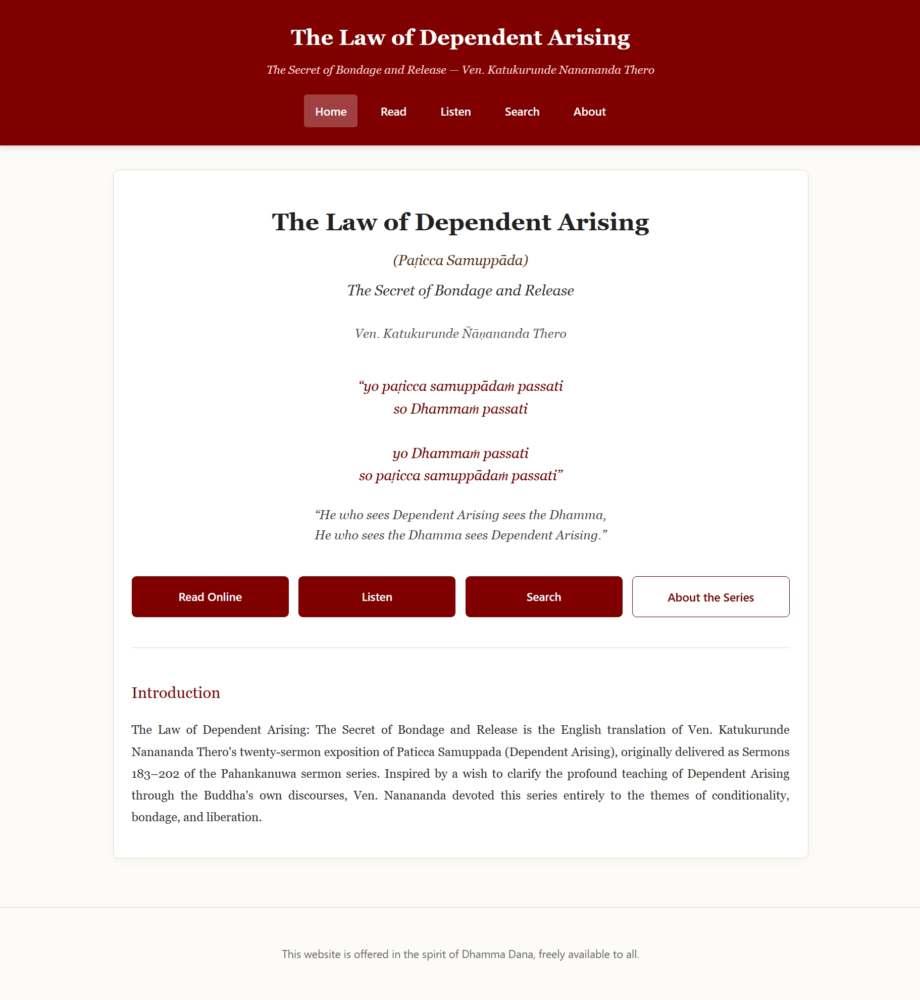

##### Website

🌐 **Read Online:**  
https://chamaniw.github.io/law-of-dependent-arising/

# The Law of Dependent Arising
### *Paṭicca Samuppāda*
### *The Secret of Bondage and Release*

*A gift of Dhamma dedicated to the preservation and dissemination of Ven. Katukurunde Ñāṇananda Thero's Paṭicca Samuppāda Sermons (183–202).*

---

> **"He who sees Dependent Arising sees the Dhamma.
> He who sees the Dhamma sees Dependent Arising."**

---

## About

This website is dedicated to Ven. Katukurunde Ñāṇananda Thero's celebrated series of twenty sermons on **Paṭicca Samuppāda**, later published as:

**The Law of Dependent Arising: The Secret of Bondage and Release**

The project aims to make these profound teachings freely accessible through online reading, search, audio recordings, and downloadable resources.

In accordance with the venerable author's expressed wish, this work is offered as a gift of Dhamma, freely available to all.

---

## Why This Series?

Soon after his enlightenment, the Buddha reflected on two profound aspects of the Dhamma:

- **Paṭicca Samuppāda** (Dependent Arising)
- **Nibbāna**, the stilling of all preparations (*sabba-saṅkhāra-samatha*)

Recognising the depth and subtlety of Dependent Arising, Ven. Ñāṇananda devoted this series entirely to clarifying its meaning through the Buddha's own discourses.

While many readers know his renowned work *Nibbāna – The Mind Stilled*, this later series offers a sustained exploration of conditionality, bondage, and liberation.

---

## Features

✅ Complete English translations

✅ Mobile-friendly online reading

✅ Full-text search

✅ Audio recordings and narration

✅ PDF downloads

✅ Concept and reference indexes

---

## Dhamma Dana

> "It is the express wish of Venerable Bhikkhu Kaṭukurunde Ñāṇananda that all his Dhamma books and recorded sermons be offered as a pure gift of Dhamma free of charge to the Dhamma-thirsty world."

